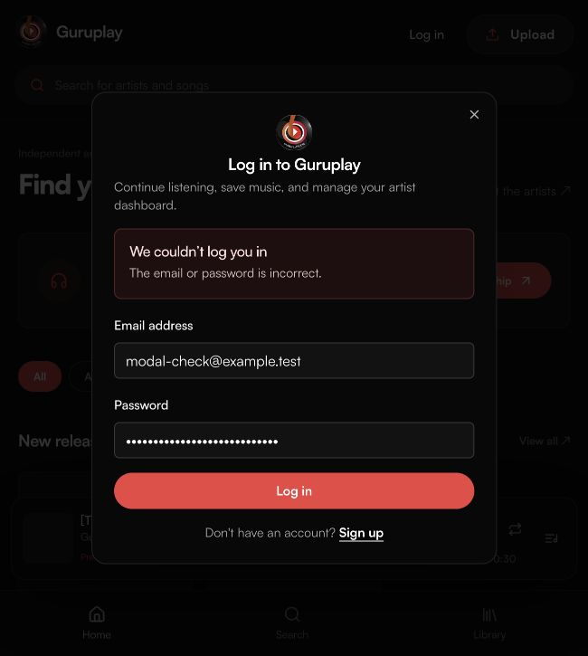
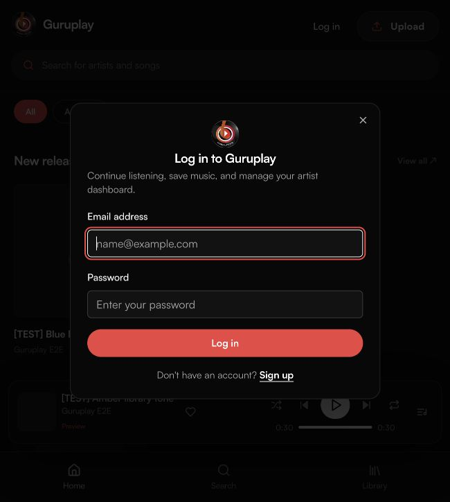
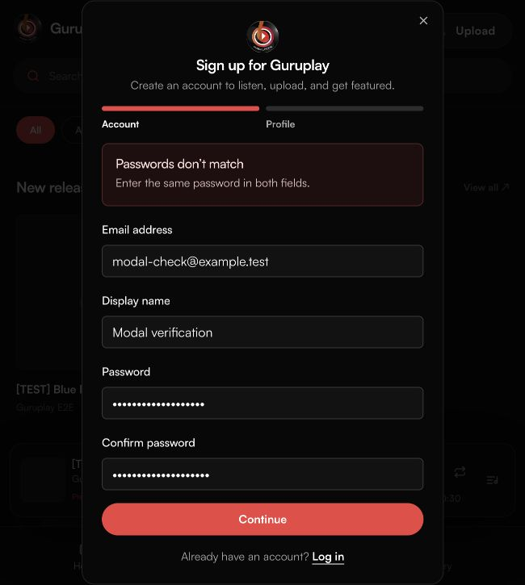

# Dialog handoff and readable authentication errors

Verified on 31 October 2026 against the local application and configured Supabase backend.

The player now closes its upgrade prompt before opening authentication. A preview finishing while authentication is open does not open another dialog. Player dialogs are unmounted while authentication is active; queue selection closes the queue before starting another track. Closing authentication does not restore a dismissed upgrade prompt.

Both listener and admin authentication forms show one inline error with a readable heading and recovery message. Internal codes are retained for application logic and omitted from the interface. Password mismatches stay in the form. Unknown backend errors no longer pass database details into user-facing messages; known confirmation, rate-limit, permission, network and session failures retain useful recovery instructions.

## Verification

- Started a real 30-second audio preview, opened login while it played, and waited for cutoff. Exactly one dialog remained: login. No upgrade heading was present.
- Submitted an incorrect login for a disposable test address. The form displayed “We couldn’t log you in” and “The email or password is incorrect.” No technical code or duplicate error toast appeared.
- Closed authentication after preview cutoff. No upgrade prompt reopened.
- Finished a second preview using the playback-position keyboard control. Only the upgrade prompt opened. Clicking Subscribe with Paystack replaced it with exactly one login dialog.
- Switched from login to signup within the same dialog. A password mismatch produced “Passwords don’t match” and “Enter the same password in both fields.” No account was created by this validation check.
- Opened the play queue and selected its generated test track. The queue closed, the track played, and no dialog remained open until normal preview cutoff.
- `npm run check` passed: both applications type-checked and built, all 11 automated tests passed, and lint had zero errors with four existing Fast Refresh warnings.
- Three new regression tests cover readable authentication recovery, malformed errors and safe unknown-error fallbacks, and preservation of explicit application recovery messages.

Cleanup removed all four temporary accounts and two generated audio tracks, including source files and processed previews. Fresh comparison confirmed the original users, artist profile and subscription were unchanged. See [cleanup receipt](modal-cleanup-status.json). No payment was initiated by the signed-out handoff test.

