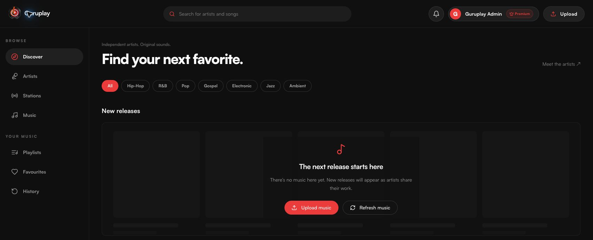
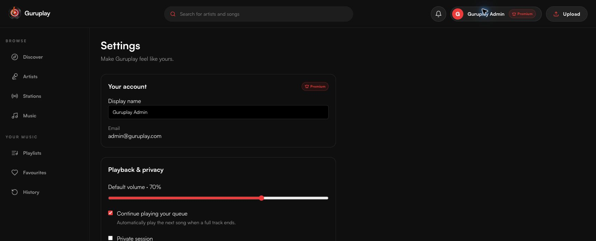
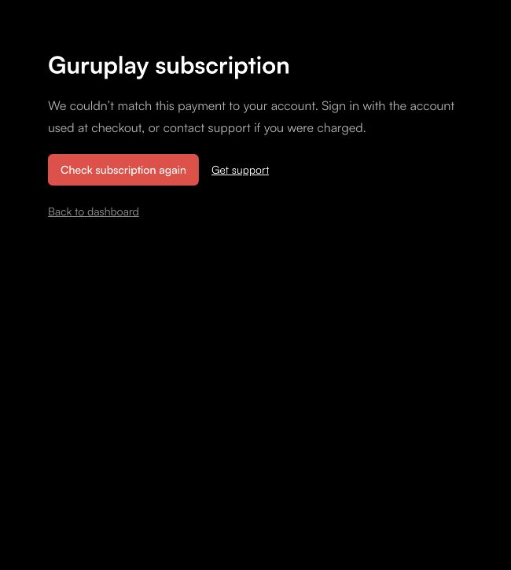

# Subscription return and Premium account UX

Verified against the local application, the configured Supabase project and the existing Paystack test payment on 31 October 2026.

## Cause and changes

The listener was opened on `localhost`, while the configured payment callback used `127.0.0.1`. These origins retained different signed-in accounts. The provider payment succeeded for the checkout’s original account, but the return request used the other account’s session and correctly failed the checkout ownership check.

Test checkout callbacks now retain the requesting loopback origin when it uses the configured port. Production continues to use the configured HTTPS application URL. Arbitrary hosts, credentials, other ports and malformed origins cannot override it. The omitted-origin API behavior is preserved.

The return page verifies the reference for the signed-in account, refreshes server entitlement, updates the account-scoped subscription cache, and replaces the return route with `/dashboard` only after both checks succeed. Repeated verification of an already verified, owned checkout returns without reapplying its payment. A successful subscription on the wrong account cannot hide a failed checkout ownership check.

One shared subscription query controls the membership offer, Premium badge in the account menu/profile/dashboard, and player upgrade prompt. Pending subscription checks do not flash a membership offer. Status comes from the authenticated API, with runtime response validation, request cancellation and account-specific cache keys.

Failed returns provide a readable explanation, Check subscription again and support actions. They do not offer another payment from the callback page. Normal subscription management remains available without a return reference.

## Evidence

- Confirmed the original pending payment with Paystack and matched the stored reference, account email, plan, amount and currency.
- Opened that existing payment’s return link in its matching signed-in account. The normal verification endpoint recorded the checkout as verified and the subscription as active. The browser reached `/dashboard` and showed Premium.
- Reopened discovery for the recovered subscriber: zero Explore membership links and a visible Premium badge.
- Revisited the verified return URL: it reached `/dashboard` again, and a fresh database comparison confirmed every subscription field and paid period was unchanged.
- Verified Premium in an existing subscriber’s account/profile view.
- A disposable unpaid account retained the membership offer and had no Premium badge. An invalid return stayed on the recovery screen, exposed no payment button, and did not grant access. Attempting to verify another account’s owned checkout returned 404.
- No new checkout was initialized for these checks. The original subscriber’s record was unchanged, and the single disposable account was removed. See [structured results](subscription-e2e-status.json).
- `npm run check` passed: both apps type-checked and built; all 18 automated tests passed; lint reported zero errors and four existing Fast Refresh warnings.
- New tests cover local callback-origin preservation and rejected overrides, provider query parsing, ownership errors even for already subscribed users, verified return handling, delayed entitlement, and service failures without false Premium access.

The provider contract requires server verification before granting access: [Paystack payment verification](https://paystack.com/docs/payments/verify-payments/). The existing account, reference, amount, currency and plan checks remain enforced.

