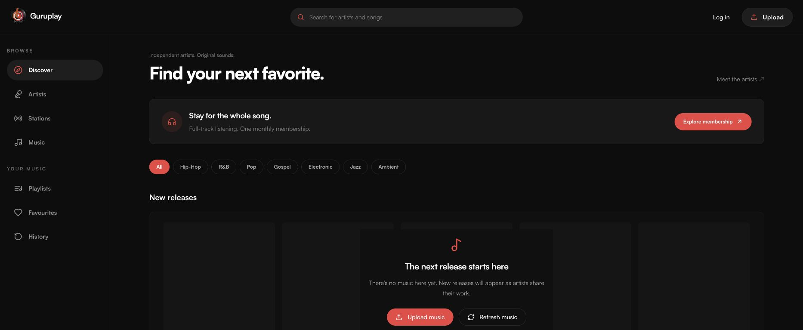
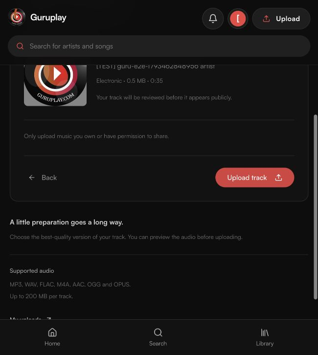
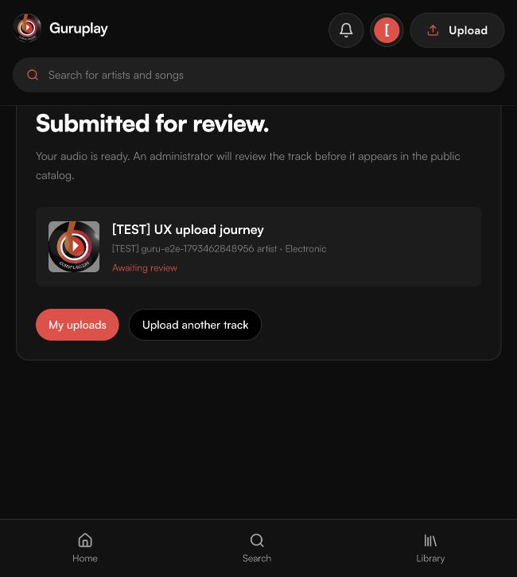
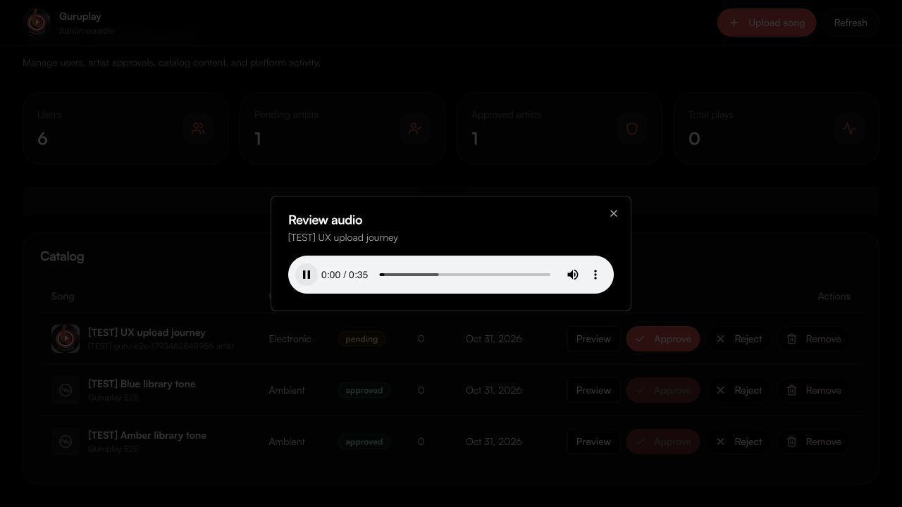
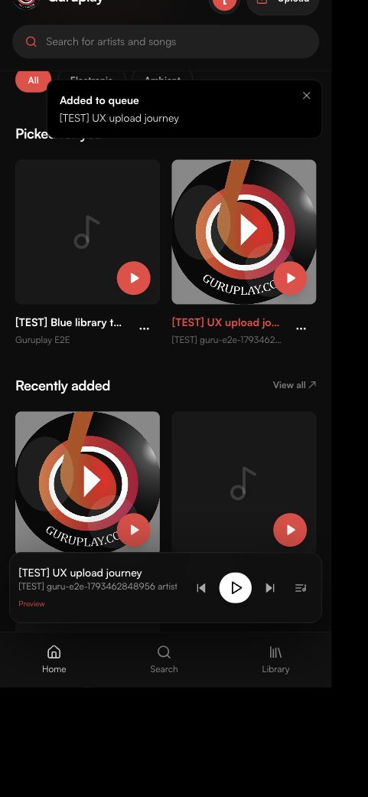

# Guruplay upload and discovery UX acceptance

Verified on 31 October 2026 against the local listener app at `http://localhost:8080`, admin app at `http://localhost:8081`, and the configured Supabase project `fuquclbwwofwugkxirrl`.

## Delivered

- Branch `feat/audiomack-upload-ux` is checked out in the root workspace and both existing app repositories. The root baseline includes the pre-existing workspace; nested Git histories and earlier work were preserved.
- A persistent header Upload link opens a dedicated Audio → Details → Review workflow. Sign-in continues on the upload route. Upload access still requires an active admin or approved artist.
- Audio selection includes supported-file and size validation, local playback, optional artwork, required metadata, review, actual operation labels, safe retries, and an owner-scoped processing result. Artist submissions remain pending moderation. The server accepts an optional upload UUID; identical retries return the original record and job. Existing callers can still omit it.
- Discovery now uses cover tiles, genre filtering, global search, consistent navigation, responsive spacing, and genuine catalog data. The primary color remains `0 84% 60%`.
- Music loading uses layout-matching skeletons. An empty catalog settles into static placeholders with a clear explanation, Upload and Refresh actions. Failed queries have a retry fallback.
- The oversized orange connection warning was replaced with a compact, dismissible notice for actual offline status. Estimated RTT/downlink no longer produces a persistent warning. Ordinary success notifications are bounded to 360 px and positioned above content rather than over mobile navigation or the player.
- No source-code comments were added. No database migration was required.

The reference was [Audiomack](https://audiomack.com/) and its Song upload entry. The external creator flow required email confirmation, so reference inspection ended at that gate. The working upload tests below were performed against Guruplay.

## Browser and backend results

| Flow | Observed result |
| --- | --- |
| Header Upload while signed out | Opened `/upload` with an actionable sign-in gate; signing in continued on the same route. |
| Invalid audio | A `.txt` file was rejected with a supported-format explanation. Continue remained unavailable without valid audio. |
| Audio preview | Generated 35-second WAV selected through the real file chooser; local player reported `paused: false`, `readyState: 4`, duration 35. |
| Details and review | Title, artist, Electronic genre and PNG artwork appeared correctly in the review step. |
| Submit and processing | Browser uploaded audio and cover, registered one song and one job, and displayed the processing result. The worker completed on its first attempt. |
| Pending privacy | The result changed to “Submitted for review.” The listener's public catalog excluded the track. |
| Admin review | Admin opened the real private review player. Playback reported `paused: false`, `readyState: 4`, duration 35. Approve persisted and the song entered the public catalog. |
| Public playback | Clicking the discovery tile started the public preview. The player changed to Pause and advanced to 0:06, with a 0:30 preview duration. |
| Header search | Submitting “UX upload journey” navigated to `/search?q=UX%20upload%20journey` and returned the approved track. |
| Saved songs and playlists | Saved the uploaded song, created a private playlist through the track menu, and verified its one-track membership in the playlist page and database. |
| Settings | Changed the disposable artist's display name, saved, reloaded, and confirmed the value in both the UI and database. |
| Mobile layout | Checked discovery, player, header Upload, sign-in gate and notifications at an effective Chrome viewport width of 433 CSS px. Document width matched viewport width. Chrome clamped the requested 390 px override; a physical 375/390 px device was not claimed as tested. |
| Notification obstruction | Reproduced a bottom notification covering navigation, moved it, and verified a 360 px notification at y=144 while Library navigation remained clickable. |
| Keyboard and color | Skip to content moved focus to `main-content`. The computed primary variable remained `0 84% 60%`. |
| Empty catalog | After fixture cleanup, real loading skeletons resolved to the empty fallback. Refresh remained usable and Upload opened the sign-in gate. |

Chrome file selection required an extension file-access permission that was not enabled. The same upload test completed through the in-app browser's supported file chooser. No browser security setting was changed.

Live permission and retry checks passed for anonymous callers, listeners, pending artists, approved artists and admins. They covered invalid IDs, blank genres, foreign storage paths, identical retries without duplicates, changed metadata returning 409, and another uploader's ID returning 404. Two setup uploads without an upload UUID also succeeded, verifying the legacy API branch. See [upload results](ux-upload-status.json).

The existing real-backend regression suite passed all 14 groups covering settings validation, saved-song persistence and isolation, playlist order and revisions, unpublished tracks, history/private sessions, support, review audio, paused accounts and moderation denial. See [regression results](ux-regression-status.json).

## Code checks and cleanup

`npm run check` passed: both apps type-checked and built, all eight automated tests passed, and lint reported zero errors with four existing Fast Refresh warnings. The listener type check and build passed again after final padding and confirmation-scroll adjustments. `git diff --check` and Node syntax checks passed. Privileged environment values were absent from tracked source and both browser bundles.

Cleanup removed four disposable accounts, three generated songs, their playlists, saved tracks, support tickets, cover artwork, source audio and processed audio/previews. Fresh checks confirmed the original two users, one artist profile and one subscription were unchanged; the original empty catalog was restored. See [cleanup receipt](ux-cleanup-status.json). The local apps and media worker remain available.

A physical offline/reconnect transition and a forced Supabase outage were not exercised. No new Paystack purchase, production deployment, or external Audiomack upload is claimed by this report.

## Evidence

Additional screenshots: [populated desktop discovery](ux-home-desktop.png), [catalog loading](ux-catalog-loading.png), [mobile empty state](ux-home-empty-mobile.png), [private playlist](ux-playlist.png), [settings after reload](ux-settings.png), and [mobile upload gate](ux-upload-mobile.png).

The optional live script `node scripts/ux-upload-e2e.mjs` expects the temporary ledger created by `node scripts/personal-e2e.mjs --setup` and the browser upload named `[TEST] UX upload journey`. Run it before approving that upload, then complete moderation and execute scoped cleanup. It deliberately fails without the disposable fixtures.
